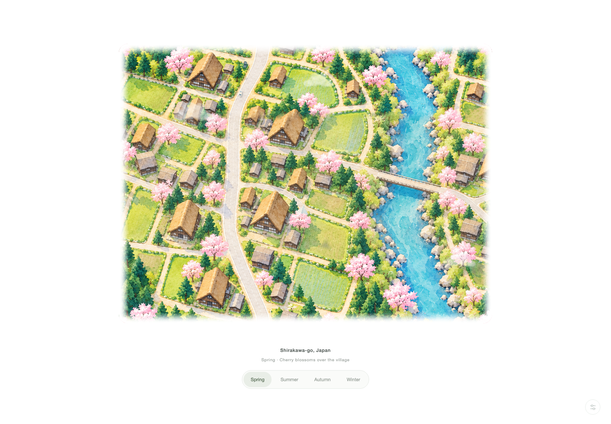
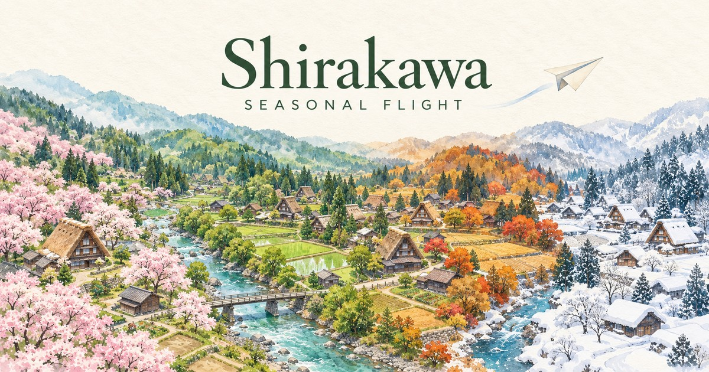

# Shirakawa · Seasonal Flight

An illustrated journey over Shirakawa-go, Japan, with four watercolor seasons and a drifting paper plane.

## Screenshot



## OG image



## Features

- Spring blossoms, lush summer fields, autumn foliage and winter snow
- Smooth forward-flight transitions between seasons
- Animated river, traffic, clouds and seasonal particles
- Pinch and wheel zoom from 1× to 2.5×
- Original 70 BPM acoustic Lo-fi soundtrack, approximately 2 minutes 45 seconds
- Central settings for animation, particles, flight speed, music and volume
- Keyboard controls and reduced-motion support

## Run locally

No build tools or JavaScript dependencies are needed.

```sh
python3 -m http.server 8000 --directory docs
```

Open http://localhost:8000. Use Space to pause or resume flight and Escape to close settings. Browsers may require the first click or tap before playing music.

## GitHub Pages

In repository **Settings → Pages**, select **Deploy from a branch**, branch **main**, folder **/docs**, then Save. GitHub automatically publishes subsequent commits to this folder.

All asset URLs are relative, so the application works under a GitHub Pages project path.

The canonical URL and social sharing image URLs in `docs/index.html` point to `https://roysung.github.io/shirakawa-seasonal-flight-website/`. Update these absolute URLs if the site moves to another domain or repository path.

## Project structure

- `docs/`: deployable HTML, CSS, JavaScript and illustration/audio assets
- `scripts/compose-lofi.py`: reproducible original soundtrack composition
- `requirements.txt`: Python packages needed only to regenerate the soundtrack

## Regenerate the soundtrack

Requires Python 3, FFmpeg, NumPy and SciPy.

```sh
python3 -m pip install -r requirements.txt
python3 scripts/compose-lofi.py
```

The script writes `docs/assets/village-watercolor-acoustic.mp3`.

## Artwork and audio

The watercolor illustrations were created for this project using image generation. The soundtrack is an original deterministic synthesis composition. The running application uses the `flat-*` artwork and `village-watercolor-acoustic.mp3`.

The Shirakawa-go farmhouse favicon and four-season social preview were also created with image generation. The favicon is exported as a multi-size ICO plus PNG icons; `docs/assets/og-shirakawa.jpg` is the 1200 × 630 social preview.
